  

  

  

  

  <b>Repos públicos:</b>
  <a href="https://github.com/EmerLima/EMSE">EMSE</a> ·
  <a href="https://github.com/EmerLima/PruebaGIT">PruebaGIT</a>
  &nbsp;&nbsp;|&nbsp;&nbsp;
  <a href="https://emerlima.github.io/EmerLima/">Ver la versión interactiva</a>

  

Ver el perfil en texto

**Emerson Limachi** · desarrollo, electrónica y automatización · Argentina

Estudiante de Ingeniería Electrónica en la UTN (3er año). Orientado a software embebido e integración HW/SW. Busca incorporarse a un equipo de desarrollo con proyectos desafiantes. Idiomas: español nativo, inglés intermedio.

**Stack:** C, C++, Python, SQL · ESP32, Arduino, STM32, MCUXpresso · Qt Creator, Linux, Windows, Git, GitLab, Visual Studio, Home Assistant, Google Sheets · UART, SSH, TCP/IP · Claude Code, Codex

| Período | Dónde | Rol |
|---|---|---|
| 04/2025 – 06/2026 | Laser Argentina S.A. | Técnico Electrónico: testeo funcional, carga de firmware, redes en Linux y diagnóstico de hardware |
| 02/2022 – 08/2023 | Sunzone | Desarrollador de Software Embebido: software en C, depuración sobre hardware y prototipos con Arduino |
| 02/2019 – 10/2019 | Sirion S.A. | Técnico Electrónico (pasantía): montaje de tableros y control de calidad |

**Proyectos:** plataforma de testing para equipos electrónicos (Electron, React, TypeScript, Spring Boot, Supabase; en desarrollo) · sincronización con Google Sheets (Python, Flet; en diseño) · domótica DIY (ESP32, ESPHome, Home Assistant; en diseño) · Smart USB de diagnóstico (concepto).

